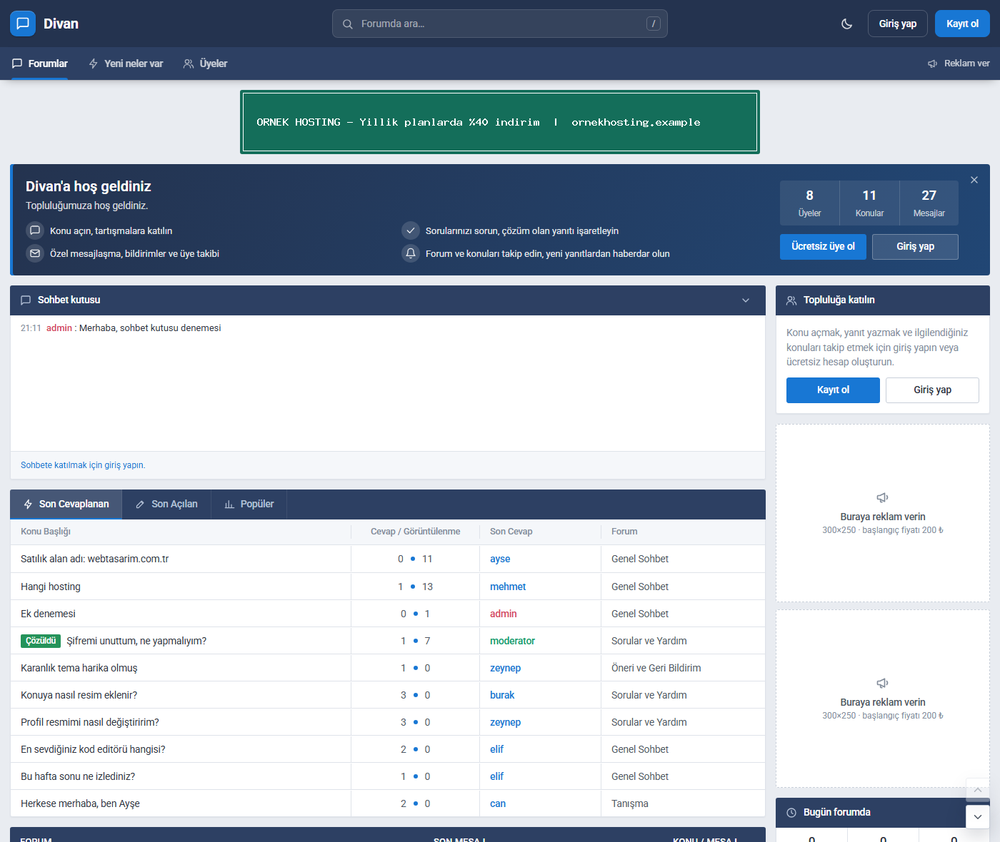
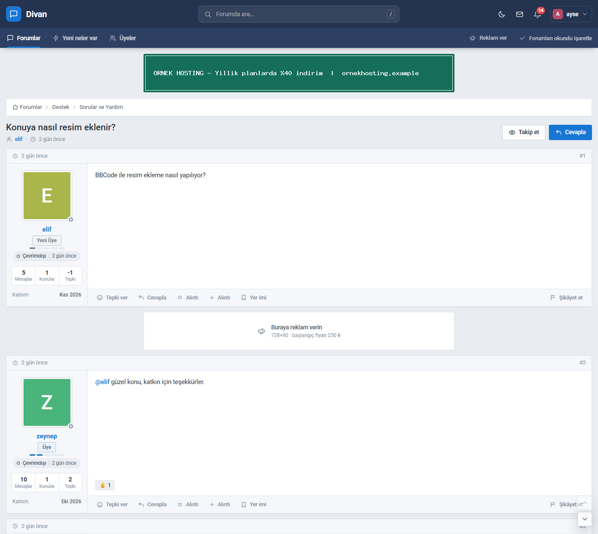
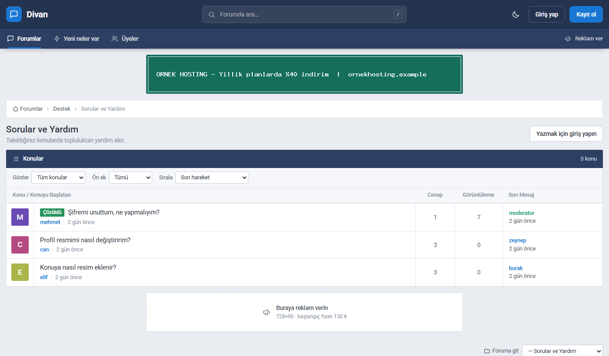
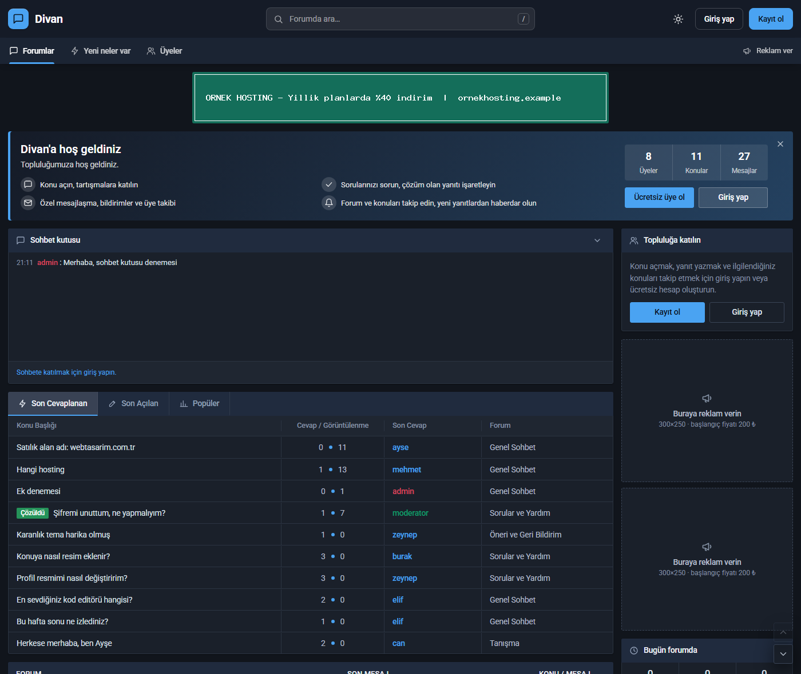
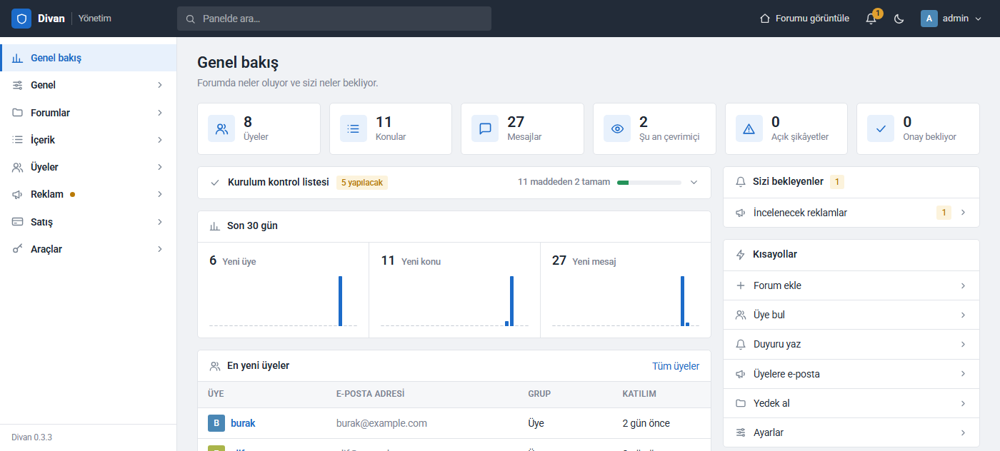
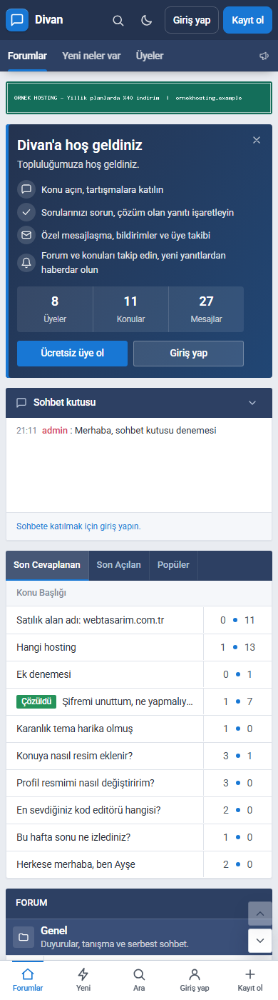

# Divan Forum

**English** · [Türkçe](README.tr.md)

Forum software in the style of XenForo and vBulletin, built on Laravel 13. No Node.js and no build
step: PHP, a database and a web server are enough. The interface comes in Turkish and English.

Divan is **free to use, with a licence code**. Every installation asks for a code that you get free of
charge from [webdanismani.com](https://webdanismani.com). The source is published so that you can read
and adapt it; it is not open-source software — see [Licence](#licence).

## Screenshots

Live demo: **[forum.webdanismani.com](https://forum.webdanismani.com)**



| Thread | Forum |
| --- | --- |
|  |  |

| Dark mode | Admin panel |
| --- | --- |
|  |  |



The screenshots show the software as it is in this repository, with demo data.

## Getting a licence code

1. Open [webdanismani.com](https://webdanismani.com) and order the free **Divan Forum** product.
2. You receive the code as soon as the order is complete.
3. Enter it in the installer. The code is tied to the address of your forum (one code = one forum);
   before you move the forum to another address, release the code under **Admin › Tools › Licence**.

Without a working code the installer does not go on.

## Features

- **Node tree**: nested categories, forums, sub-forums and link forums
- **Threads and posts**: BBCode editor with toolbar, server-side preview, drafts, emoji picker, optional
  visual (WYSIWYG) mode, quotes and multi-quote, @mentions, prefixes, sticky / locked threads, unread
  tracking
- **Content**: polls, tags, solved answers in question forums, bookmarks, edit history, embedded
  YouTube / Vimeo / Dailymotion / X / Instagram links, file attachments (drag and drop, thumbnails,
  stored outside the web root and protected by the forum permissions)
- **Permissions**: user groups (primary + secondary), `allow / never / not set` values, overrides per forum
- **Moderation**: soft / hard delete, restore, move, merge, copy, split, approval queue, reports,
  moderator log, forum moderators, spam cleaner, word censor, warnings with expiring points and
  automatic bans, bulk actions
- **Community**: reactions, private conversations, alerts, profiles with avatar, cover and signature,
  following and ignoring, profile posts, custom profile fields, titles, badges, automatic group
  promotions, who is online, shoutbox, live alert counters
- **Watching and e-mail**: watched threads and forums, notification e-mails, daily / weekly digest;
  mail is queued and sent by background tasks
- **Account security**: two-step sign-in (TOTP with recovery codes), sign-in with Google / GitHub,
  e-mail verification, phone verification by SMS (NetGSM, Twilio or any HTTP gateway), IP logs, IP and
  e-mail bans, honeypot + timing check, Turnstile / reCAPTCHA and StopForumSpam on registration
- **Advertising manager**: fixed ad zones, price list by duration, members order a zone and upload their
  banner, card payment through PayTR or bank transfer, automatic publishing after payment, impression
  and click counters, text links, sponsored threads, coupons, renewal reminders, printable receipts
- **Wallet and sales**: member balance (top up by card or transfer), paid thread promotion (sticky,
  highlight, bump), paid membership upgrades, payments and ledger in the admin panel
- **Marketplace**: forums marked as marketplaces hold listings (for sale / wanted / service, price,
  open-sold-closed), a `/market` page with filters, trader feedback and score on profiles
- **Search**: titles and post bodies, permission-aware; full-text index on MySQL / MariaDB; filters by
  forum, member, date and tag
- **Site content and SEO**: custom pages, notice bars, menu and footer links, contact form, mass e-mail,
  `sitemap.xml`, `robots.txt`, RSS feeds, structured data (JSON-LD)
- **Customisation**: colour schemes, light / dark mode, home page sections, logo, extra CSS / HTML,
  phrase editor, template editor, installable themes, add-on system ([addons/README.md](addons/README.md)),
  safe mode for recovery (`FORUM_SAFE_MODE=true`)
- **REST API and webhooks**: `/api/v1` with keys members create themselves (a key acts with its owner's
  permissions), signed webhook calls for new threads, replies and members
- **Installable app and push**: web app manifest (PWA), offline page, browser push notifications
  (Web Push / VAPID, no extra service needed)
- **AI helpers** (optional, need an API key of your own): spam check on the first posts of new members,
  summaries of long threads; plus "similar threads" without any AI
- **Importers**: members (with their old passwords), forums, threads and posts from XenForo 2,
  vBulletin 3 / 4, MyBB 1.8 and SMF 2.0 / 2.1 — from the admin panel or with `php artisan forum:import`
- **Market for modules and themes**: the Market page in the admin panel lists the vendor's extra modules
  and themes, opens orders, downloads the package after payment, checks its signature (Ed25519) and
  installs it; the forum itself is updated from there with one click
- **Installation and upkeep**: web installer (`/install`), database updates from the admin panel,
  background tasks that need no cron

## Requirements

- PHP 8.3 or newer with `pdo_sqlite` or `pdo_mysql`, `mbstring`, `openssl`, `fileinfo`, `gd`, `intl`,
  `sodium`, `zip`, `curl`
- Composer
- SQLite (default), MySQL / MariaDB or PostgreSQL

## Installation

**Web installer.** Run `composer install`, upload the files (including `vendor/`) and point the web
server at the `public/` folder. Open the site: while there is no `.env` file the installer at `/install`
checks the requirements and asks for the licence code, the database and the first administrator. It
closes itself as soon as the first member exists.

**Command line.**

```bash
composer install
cp .env.example .env          # Windows: copy .env.example .env
php artisan key:generate
# set APP_URL in .env to the address of the forum: the licence code is tied to it
php artisan forum:install     # asks for the licence code, creates the tables, default groups and the first administrator
php artisan serve             # http://127.0.0.1:8000
```

`forum:install` also runs without questions:

```bash
php artisan forum:install --license=XXX-XXXX-XXXX-XXXX-XXXX --username=admin --email=admin@example.com --password="a-strong-password"
```

## Development

For work on your own machine set `APP_ENV=local` and `APP_DEBUG=true` in `.env` (the example file is made for a
live board: production mode, no debug pages).

```bash
php artisan migrate:fresh --seed   # demo data; sign in with admin / password (never on a live site)
php artisan test                   # feature tests, in-memory SQLite
php artisan forum:lang-keys        # lists interface strings missing in lang/tr.json
```

Interface strings are written as English keys in the code (`__('New thread')`); the Turkish text is in
`lang/tr.json`. CSS and JavaScript are plain files in `public/assets`.

| Path | What it holds |
| --- | --- |
| `config/forum.php` | Product identity, permission catalogue, schema of the settings edited in the admin panel |
| `app/Forum/Permissions/PermissionResolver.php` | Resolves group and node permissions |
| `app/Forum/Posting.php` | Every thread / post write: counters, alerts, moderator log |
| `app/Forum/BbCode/Renderer.php` | Safe BBCode → HTML renderer |
| `app/Forum/NodeTree.php` | The node tree in memory and what a visitor may see |
| `app/Forum/Settings.php` | Board settings (`setting('board.name')`) |
| `app/Forum/Ads.php`, `app/Forum/Payments/` | Ad orders; card / transfer payments and the one place where a payment becomes "paid" |
| `app/Forum/Wallet.php` | Member balance; every movement is written to the ledger |
| `app/Forum/Tasks.php` | Background tasks (after visitor requests, or `php artisan forum:run-tasks`) |
| `app/Forum/Addons/`, `app/Forum/Themes.php` | Add-on manager and installable themes |
| `app/Forum/Store/Client.php` | Talks to the market and checks package signatures |
| `app/Forum/License/` | Licence codes: talking to the licence server (`Licenses`), checking the signature chain (`Verifier`) |
| `app/Forum/Setup/` | Web installer, updater and the `.env` writer |
| `resources/views`, `public/assets` | Blade templates, one stylesheet and one script |

## Sign-in with other accounts

A provider whose client id and secret are entered under **Admin › Settings › Sign-in with other accounts**
appears as a button on the sign-in and registration pages. Callback addresses to register with the
provider: `https://<your-domain>/auth/google/callback` and `https://<your-domain>/auth/github/callback`.

## Advertising and payments

Ad zones are fixed places in the templates; their titles, sizes and price lists are edited under
**Admin › Ad zones**. The prices that come with the installation are examples.

- **PayTR**: once the merchant number, key and salt are entered, "Pay by card" appears. Set the
  *notification URL* in the PayTR panel to `https://<your-domain>/ads/payment/paytr`. An order counts as
  paid only when that notification has been verified. Make a test payment before going live.
- **Bank transfer**: appears once the account details are entered; the member reports the transfer and
  the administrator confirms it.

## Licence codes of modules and themes

Each module and theme sold in the market gets a licence code of its own for the forum that bought it; it
does not run until that code is entered under **Admin › Tools › Licence**. The forum asks the licence
server about its codes once an hour and checks every answer against a signature chain that ends in a key
built into the software. If the server cannot be reached, a licence keeps working on its last answer for
a few days.

## Licence

Divan is published under the [Divan Forum Licence](LICENSE) ([Türkçe](LICENSE.tr.md)). In short:

- free to use, also commercially, with a licence code for each installation;
- you may change the code for your own forum and send improvements back;
- you may not redistribute or sell it, and you may not remove the licence check.

Copyright © 2026 [Web Danışmanı](https://webdanismani.com).
