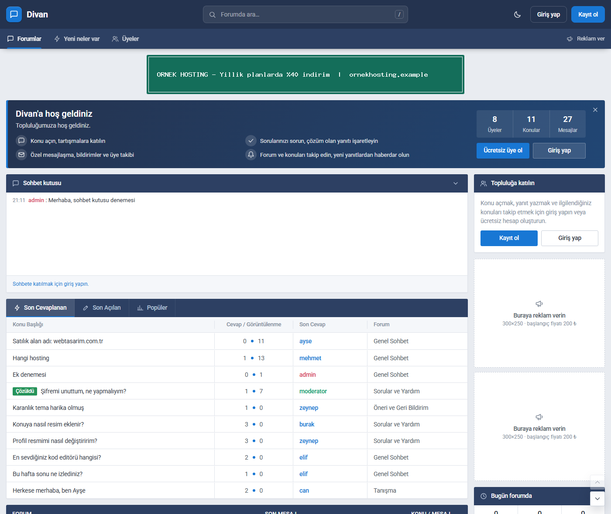
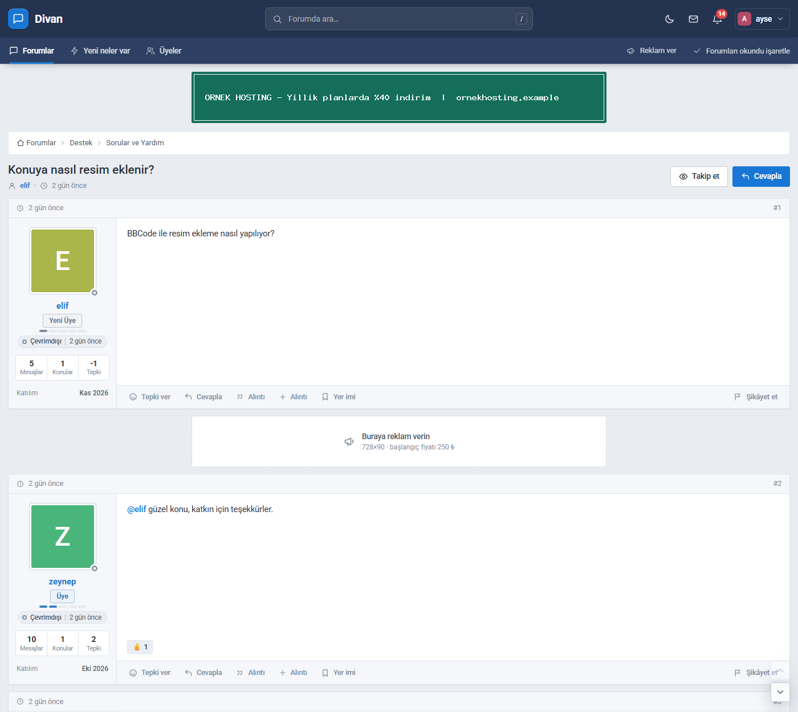
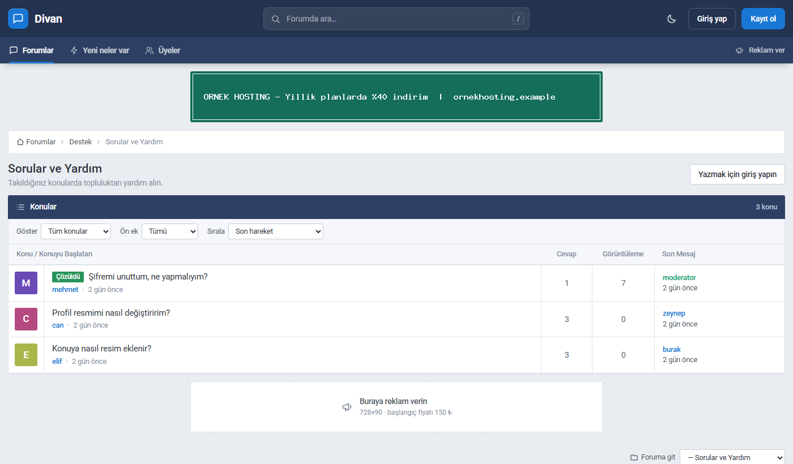
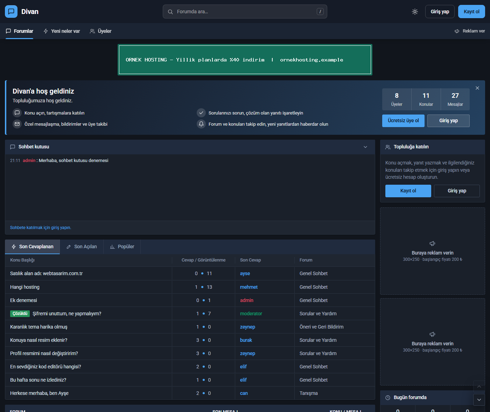
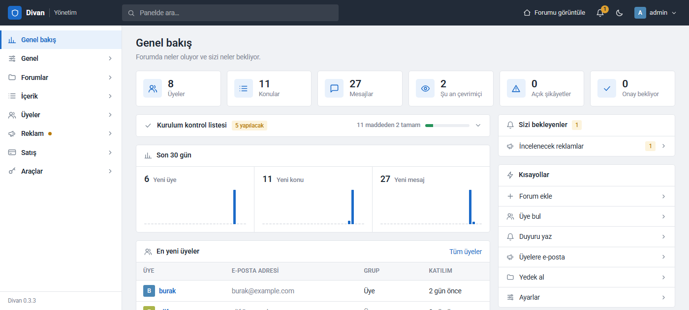
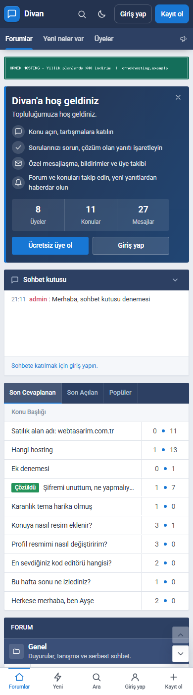

# Divan Forum

[English](README.md) · **Türkçe**

Laravel 13 üzerine kurulu, XenForo / vBulletin tarzında forum yazılımı. Node.js ve derleme adımı
gerektirmez: PHP, bir veritabanı ve bir web sunucusu yeterlidir. Arayüz Türkçe ve İngilizcedir.

Divan **ücretsizdir, lisans koduyla çalışır**. Her kurulum, [webdanismani.com](https://webdanismani.com)
adresinden ücretsiz aldığınız bir kod ister. Kaynak kodu okuyabilmeniz ve uyarlayabilmeniz için
yayımlanmıştır; açık kaynak bir yazılım değildir — bkz. [Lisans](#lisans).

## Ekran görüntüleri

Canlı demo: **[forum.webdanismani.com](https://forum.webdanismani.com)**



| Konu | Forum |
| --- | --- |
|  |  |

| Koyu mod | Yönetim paneli |
| --- | --- |
|  |  |



Görüntüler, yazılımın bu depodaki hâlini demo verisiyle gösterir.

## Lisans kodu almak

1. [webdanismani.com](https://webdanismani.com) adresini açın ve ücretsiz **Divan Forum** ürününü sipariş edin.
2. Sipariş tamamlanır tamamlanmaz kodunuzu alırsınız.
3. Kodu kurulum ekranına girin. Kod forumunuzun adresine bağlanır (bir kod = bir forum); forumu başka
   bir adrese taşımadan önce kodu **Yönetim › Araçlar › Lisans** sayfasından serbest bırakın.

Geçerli bir kod girilmeden kurulum ilerlemez.

## Özellikler

- **Düğüm ağacı**: iç içe kategoriler, forumlar, alt forumlar ve bağlantı forumları
- **Konular ve mesajlar**: araç çubuklu BBCode editörü, sunucuda üretilen önizleme, taslaklar, emoji
  seçici, isteğe bağlı görsel (WYSIWYG) mod, alıntı ve çoklu alıntı, @bahsetme, ön ekler, sabit / kilitli
  konular, okunmamış takibi
- **İçerik**: anketler, etiketler, soru-cevap forumlarında çözüm işaretleme, yer imleri, düzenleme
  geçmişi, YouTube / Vimeo / Dailymotion / X / Instagram bağlantılarının gömülmesi, dosya ekleri
  (sürükle-bırak, küçük resim; dosyalar web kökünün dışında tutulur ve forum izinleriyle korunur)
- **İzin sistemi**: kullanıcı grupları (ana + ikincil), `izin ver / asla / ayarlanmadı` değerleri, forum
  bazında geçersiz kılma
- **Moderasyon**: yumuşak / kalıcı silme, geri yükleme, taşıma, birleştirme, kopyalama, bölme, onay
  kuyruğu, şikâyetler, moderatör kayıtları, foruma özel moderatörler, spam temizleyici, kelime sansürü,
  süreli ceza puanlı uyarılar ve otomatik yasak, toplu işlemler
- **Topluluk**: tepkiler, özel konuşmalar, bildirimler, profil resmi / kapak / imza, takip ve engelleme,
  profil mesajları, özel profil alanları, unvanlar, rozetler, otomatik grup terfileri, çevrimiçi üyeler,
  sohbet kutusu, canlı bildirim sayaçları
- **Takip ve e-posta**: konu ve forum takibi, bildirim e-postaları, günlük / haftalık özet; e-postalar
  kuyruğa alınır ve arka plan görevleriyle gönderilir
- **Hesap güvenliği**: iki adımlı giriş (TOTP, kurtarma kodları), Google / GitHub ile giriş, e-posta
  doğrulama, SMS ile telefon doğrulama (NetGSM, Twilio veya herhangi bir HTTP geçidi), IP kayıtları, IP ve
  e-posta yasakları, kayıtta tuzak alan + süre denetimi, Turnstile / reCAPTCHA ve StopForumSpam
- **Reklam yöneticisi**: sabit reklam alanları, süreye göre fiyat listesi, üyelerin alan seçip banner
  yükleyerek sipariş vermesi, PayTR ile kartla ödeme veya havale / EFT, ödeme sonrası otomatik yayın,
  gösterim / tıklama sayacı, metin bağlantıları, sponsorlu konular, kuponlar, yenileme hatırlatması,
  yazdırılabilir makbuz
- **Cüzdan ve satış**: üye bakiyesi (kart veya havale ile yükleme), bakiyeden konu öne çıkarma
  (sabitleme, vurgulu başlık, yukarı taşıma), ücretli üyelik paketleri, yönetim panelinde ödemeler ve
  bakiye hareketleri
- **İlan pazarı**: ilan pazarı olarak işaretlenen forumlarda konular ilan olur (satılık / aranıyor /
  hizmet, fiyat, açık-satıldı-kapandı), süzgeçli `/market` sayfası, alışveriş değerlendirmesi ve profilde
  alışveriş puanı
- **Arama**: başlık ve mesaj içeriğinde, izinlere duyarlı arama; MySQL / MariaDB üzerinde tam metin
  dizini; forum, üye, tarih ve etiket süzgeçleri
- **Site içeriği ve SEO**: özel sayfalar, duyuru çubukları, menü ve alt bilgi bağlantıları, iletişim
  formu, toplu e-posta, `sitemap.xml`, `robots.txt`, RSS akışları, yapılandırılmış veri (JSON-LD)
- **Özelleştirme**: renk şemaları, açık / koyu mod, ana sayfa bölümleri, logo, ek CSS / HTML, metin
  düzenleyici, şablon düzenleyici, kurulabilir temalar, eklenti sistemi
  ([addons/README.md](addons/README.md)), kurtarma için güvenli mod (`FORUM_SAFE_MODE=true`)
- **REST API ve webhook'lar**: üyelerin kendi oluşturduğu anahtarlarla `/api/v1` (anahtar, sahibinin
  izinleriyle çalışır); yeni konu, yanıt ve üye için imzalı webhook istekleri
- **Uygulama olarak kurulum ve anlık bildirim**: web uygulama bildirimi (PWA), çevrimdışı sayfası,
  tarayıcı bildirimleri (Web Push / VAPID, dış hizmet gerektirmez)
- **Yapay zekâ yardımcıları** (isteğe bağlı, kendi API anahtarınızla): yeni üyelerin ilk mesajlarında
  spam denetimi, uzun konular için özet; ayrıca yapay zekâsız "benzer konular" önerisi
- **İçe aktarma**: XenForo 2, vBulletin 3 / 4, MyBB 1.8 ve SMF 2.0 / 2.1 veritabanlarından üyeler (eski
  parolalarıyla), forumlar, konular ve mesajlar — yönetim panelinden ya da `php artisan forum:import` ile
- **Modül ve tema marketi**: yönetim panelindeki Market sayfası satıcının ek modül ve temalarını listeler,
  sipariş açar, ödeme sonrası paketi indirir, imzasını (Ed25519) doğrular ve kurar; forumun kendisi de
  oradan tek tıkla güncellenir
- **Kurulum ve bakım**: web kurulum sihirbazı (`/install`), yönetim panelinden veritabanı güncelleme,
  cron gerektirmeyen arka plan görevleri

## Gereksinimler

- PHP 8.3 veya üzeri; `pdo_sqlite` veya `pdo_mysql`, `mbstring`, `openssl`, `fileinfo`, `gd`, `intl`,
  `sodium`, `zip`, `curl`
- Composer
- SQLite (varsayılan), MySQL / MariaDB veya PostgreSQL

## Kurulum

**Web sihirbazı.** `composer install` çalıştırın, dosyaları (`vendor/` dahil) sunucuya yükleyin ve web
sunucusunu `public/` klasörüne yönlendirin. Siteyi açın: `.env` dosyası yokken `/install` sayfası
gereksinimleri denetler; lisans kodunu, veritabanı bilgilerini ve ilk yöneticiyi sorar. İlk üye oluştuğu
anda sihirbaz kendini kapatır.

**Komut satırı.**

```bash
composer install
cp .env.example .env          # Windows: copy .env.example .env
php artisan key:generate
# .env içindeki APP_URL değerini forumun adresi yapın: lisans kodu bu adrese bağlanır
php artisan forum:install     # lisans kodunu sorar; tabloları, varsayılan grupları ve ilk yöneticiyi oluşturur
php artisan serve             # http://127.0.0.1:8000
```

`forum:install` soru sormadan da çalışır:

```bash
php artisan forum:install --license=XXX-XXXX-XXXX-XXXX-XXXX --username=admin --email=admin@example.com --password="guclu-bir-sifre"
```

## Geliştirme

Kendi bilgisayarınızda çalışırken `.env` içinde `APP_ENV=local` ve `APP_DEBUG=true` yapın (örnek dosya canlı bir
forum için hazırlanmıştır: üretim modu, hata ayıklama sayfaları kapalı).

```bash
php artisan migrate:fresh --seed   # demo verisi; giriş: admin / password (canlı sitede kullanmayın)
php artisan test                   # özellik testleri, bellekte SQLite
php artisan forum:lang-keys        # lang/tr.json içinde eksik arayüz metinlerini listeler
```

Arayüz metinleri kodda İngilizce anahtar olarak yazılır (`__('New thread')`); Türkçesi `lang/tr.json`
dosyasındadır. CSS ve JavaScript, `public/assets` içindeki düz dosyalardır.

| Yol | İçerik |
| --- | --- |
| `config/forum.php` | Ürün kimliği, izin kataloğu, yönetim panelinden düzenlenen ayarların şeması |
| `app/Forum/Permissions/PermissionResolver.php` | Grup ve düğüm izinlerinin çözümlenmesi |
| `app/Forum/Posting.php` | Bütün konu / mesaj yazma işlemleri: sayaçlar, bildirimler, moderatör kaydı |
| `app/Forum/BbCode/Renderer.php` | Güvenli BBCode → HTML dönüştürücü |
| `app/Forum/NodeTree.php` | Bellekteki düğüm ağacı ve ziyaretçinin görebildikleri |
| `app/Forum/Settings.php` | Forum ayarları (`setting('board.name')`) |
| `app/Forum/Ads.php`, `app/Forum/Payments/` | Reklam siparişleri; kart / havale ödemeleri ve bir ödemenin "ödendi" sayıldığı tek yer |
| `app/Forum/Wallet.php` | Üye bakiyesi; her hareket deftere yazılır |
| `app/Forum/Tasks.php` | Arka plan görevleri (ziyaretçi isteklerinin ardından ya da `php artisan forum:run-tasks` ile) |
| `app/Forum/Addons/`, `app/Forum/Themes.php` | Eklenti yöneticisi ve kurulabilir temalar |
| `app/Forum/Store/Client.php` | Marketle konuşur, paket imzalarını denetler |
| `app/Forum/License/` | Lisans kodları: lisans sunucusuyla konuşma (`Licenses`), imza zinciri denetimi (`Verifier`) |
| `app/Forum/Setup/` | Web kurulum sihirbazı, güncelleyici ve `.env` yazıcısı |
| `resources/views`, `public/assets` | Blade şablonları, tek stil dosyası ve tek betik |

## Dış hesaplarla giriş

**Yönetim › Ayarlar › Başka hesaplarla giriş** bölümüne istemci kimliği ve gizli anahtarı girilen
sağlayıcı, giriş ve kayıt sayfalarında düğme olarak görünür. Sağlayıcıda tanımlanacak dönüş adresleri:
`https://<alan-adınız>/auth/google/callback` ve `https://<alan-adınız>/auth/github/callback`.

## Reklam ve ödeme

Reklam alanları şablonlarda sabit yerlerdir; başlıkları, boyutları ve fiyat listeleri
**Yönetim › Reklam alanları** sayfasından düzenlenir. Kurulumla gelen fiyatlar örnektir.

- **PayTR**: mağaza no, mağaza parolası ve gizli anahtar girilince "Kartla öde" seçeneği açılır. PayTR
  panelinde *Bildirim URL* olarak `https://<alan-adınız>/ads/payment/paytr` tanımlanmalıdır. Sipariş
  yalnızca bu bildirim doğrulanınca ödenmiş sayılır. Canlıya geçmeden önce bir deneme ödemesi yapın.
- **Havale / EFT**: hesap bilgileri girilince açılır; üye havaleyi bildirir, yönetici onaylar.

## Modül ve temaların lisans kodları

Markette satılan her modül ve tema, satın alan foruma özel ayrı bir lisans kodu alır; kod
**Yönetim › Araçlar › Lisans** sayfasına girilmeden çalışmaz. Forum, kodlarını saatte bir lisans
sunucusuna sorar ve her yanıtı, yazılımın içine gömülü bir anahtara kadar uzanan imza zinciriyle
doğrular. Sunucuya ulaşılamazsa lisans son yanıtla birkaç gün daha çalışır.

## Lisans

Divan, [Divan Forum Lisansı](LICENSE.tr.md) ([English](LICENSE)) ile yayımlanır. Özetle:

- her kurulum için bir lisans koduyla, ticari amaçla da ücretsiz kullanılır;
- kodu kendi forumunuz için değiştirebilir, geliştirmelerinizi geri gönderebilirsiniz;
- yeniden dağıtamaz ya da satamazsınız; lisans denetimini kaldıramazsınız.

Telif hakkı © 2026 [Web Danışmanı](https://webdanismani.com).
